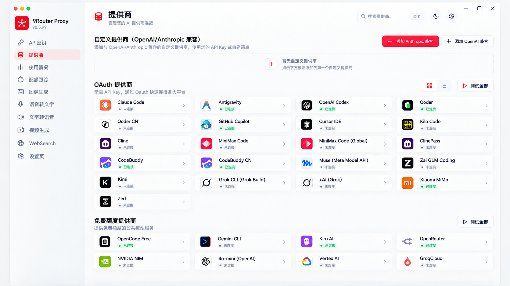
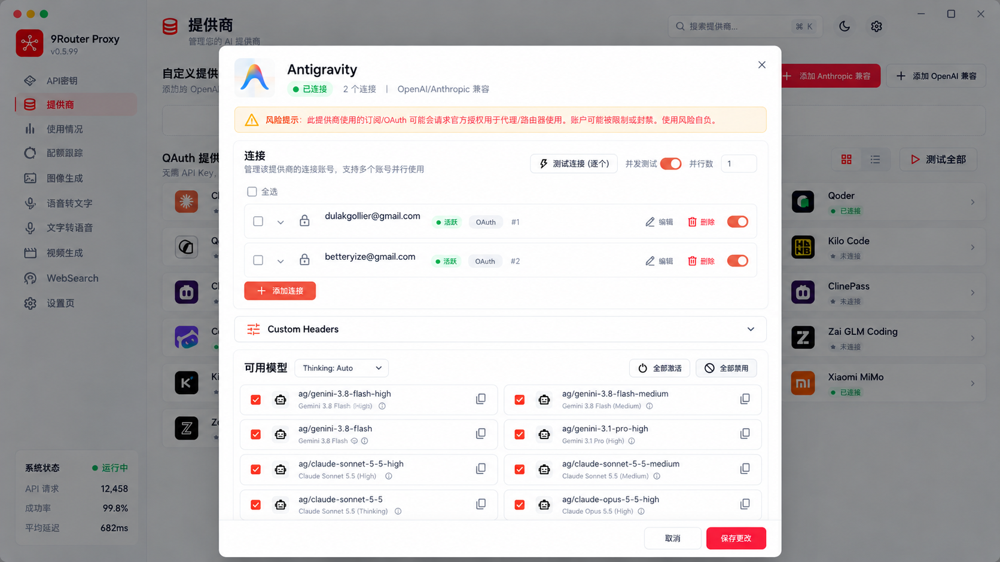
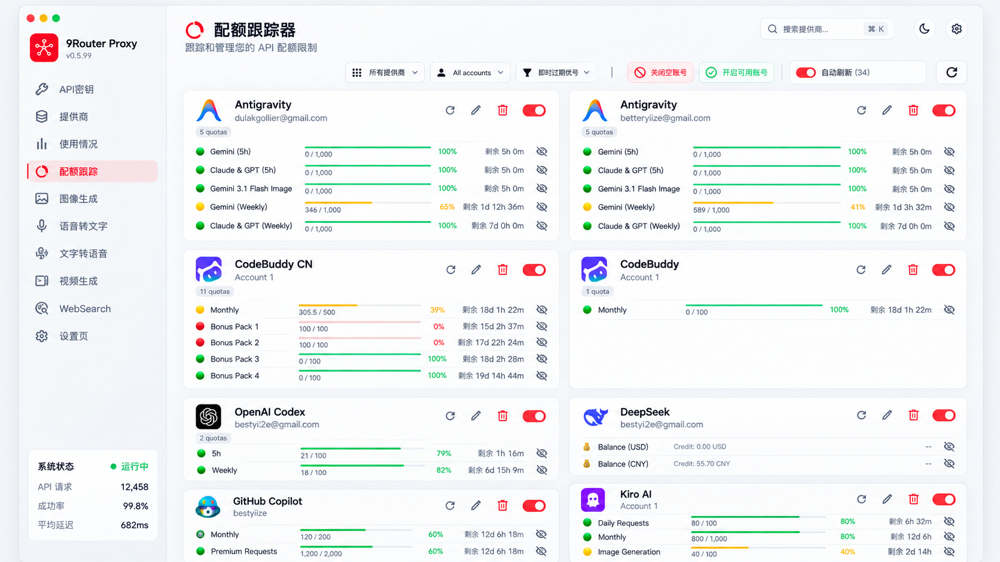
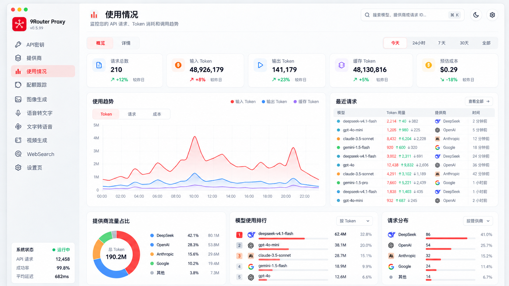

# FreeApiBox（免费 API 盒子）— 产品与 UI 设计规范

> 版本：v1.0 · 2026-10-13  
> 目标平台：Windows 10/11（x64、可选 arm64）、macOS 13+（Apple Silicon / Intel）  
> 技术栈：Rust + Tauri 2 + Vue 3 + TypeScript  
> 状态：设计基线（供 AI 编程 / 人工开发启动使用）

## 0. 产品定位与边界

本产品是运行在用户本机的 **AI API 聚合、转换与代理客户端**，参考 9Router 的连接与额度管理能力，提供原生桌面体验。它既能将不同供应商的订阅、OAuth 账户及 API Key 转换为本地统一 API，也支持图像、语音、视频、网络搜索等专门能力的接入与调试。

- **产品价值**：一个桌面客户端管理多家服务商、多个账户、多种 API 协议；可观测请求、Token、成本和配额。
- **桌面优先**：不使用嵌套网页路由模拟系统窗口；设置和供应商详情使用标准模态弹窗，窗口支持拖动、缩放、最小化、关闭。
- **不承诺无损任意协议转换**：按照上游支持情况和经过验证的适配器能力逐项实现。针对工具调用、文件与图片、流式、多模态请求需单独兼容性测试。
- **合法性/安全**：OAuth 账户接入、订阅转 API 可能受到上游服务条款限制；仅允许用户主动授权且获得许可的接口，不应通过技术手段规避服务限制。

## 1. 设计方向

### 1.1 视觉基调

整体采用 **白、灰、品牌红**：

| 用途 | 色值 | 应用 |
|---|---|---|
| 主画布 | `#FFFFFF` | 主内容页与主要弹窗 |
| 侧栏/次级画布 | `#F7F8FA` | 导航栏、灰底表面 |
| 次级背景 | `#F3F4F6` | 分组背景、搜索输入 |
| 主要文本 | `#16181D` | 标题、关键数值 |
| 次级文本 | `#677084` | 辅助描述、提示 |
| 边框 | `#E7E9ED` | 卡片、分割线 |
| 主品牌色 | `#FF2442` | 选中菜单、主按钮、强调操作 |
| 主品牌浅色 | `#FFF0F2` | 导航选中底色、轻提示 |
| 成功色 | `#16A36B` | 已连接、可用、健康 |
| 警告色 | `#F4A524` | 配额不足、待处理 |
| 错误色 | `#E44848` | 错误、已耗尽、删除确认 |

**不使用渐变色**，尤其不使用整页的红粉渐变与多彩纹理背景。彩色品牌 Logo 可以保留真实配色。红色不能承载所有状态，状态色有独立语义。

### 1.2 布局标尺

- 默认窗口建议 `1440 × 900` CSS px，最低 `1080 × 680`；支持 Windows 缩放与 macOS Retina。
- 左侧导航宽度 `224px`（可折叠为 `68px`，折叠模式工具提示展示名称）；主区域左右内边距 `28px`。
- 顶部标题栏主内容高度 `76px`（含原生窗口拖动区域的设计适配）；大标题 `24px/600`，分组标题 `17px/600`，正文 `13–14px`。
- 模块垂直间距 `24px`，卡片间隙 `12px`，卡片圆角 `10px`，边框 `1px`，不依赖重阴影。
- 供应商卡片默认高 `62px`（此前稿已加高），内部水平间距 `12px`；Logo `36px`；名称 14px / 状态 12px。
- 全局标准控件高 `34px`；主按钮 `36px`；卡片内操作图标热区不小于 `32×32px`。
- 供应商详情弹窗宽度建议 `860px`，最大 `calc(100vw - 64px)`，高度最多 `calc(100vh - 80px)`；头部/底部固定，中间独立滚动。

### 1.3 跨平台原生感

- macOS 标题栏左上角交通灯，Windows 右上角最小化/最大化/关闭；系统级关闭按钮行为遵循平台约定。
- 使用 Tauri 系统菜单、文件对话框、系统通知与托盘；macOS `Cmd+K`、Windows `Ctrl+K` 聚焦搜索。
- 支持键盘导航、焦点轮廓、浅色/深色模式（首版优先浅色）、缩放、辅助技术读屏。
- 危险操作（删除账户、清空日志、撤销密钥）二次确认；可逆操作用非阻断反馈。
- 运行状态显示在左下角，但不作为顶部一排统计卡片重复展示。

## 2. 信息架构（仅 10 个菜单）

**左侧菜单从上到下固定为：**

| # | 菜单 | 目标 |
|---|---|---|
| 1 | API 密钥 | 管理对外提供的本地访问密钥、权限与有效期 |
| 2 | 提供商 | OAuth、订阅、API Key 来源接入与模型管理 |
| 3 | 使用情况 | 请求、Token、成本、成功率、延迟与明细 |
| 4 | 配额跟踪 | 多账户配额、余额、刷新周期与告警 |
| 5 | 图像生成 | 模型、输入参数、任务历史与输出预览 |
| 6 | 语音转文字 | ASR 上传/录音转写、语言、时间戳 |
| 7 | 文字转语音 | TTS 文本、音色、参数、试听、导出 |
| 8 | 视频生成 | 创建/查看长耗时生成任务及历史 |
| 9 | WebSearch | 联网搜索供应商接入、查询与结果测试 |
| 10 | 设置页 | 本地代理、网络、安全、更新、日志、数据备份 |

不添加首页、Skills、控制台日志、翻译、媒体供应商等额外一级导航。例外：按产品负责人要求，增加「API 接入」（网关地址、请求示例；Codex / Claude Code / CC Switch 的一键接入放在「API 密钥」页）与设置页上方的「代理池」（出站代理节点、选路策略、容错）两个一级菜单；图像生成 / 语音转文字 / 文字转语音 / 视频生成 / WebSearch 五项暂时从侧栏隐藏（`nav.ts` 中 `hidden: true`，路由与页面保留）。相应能力放入已有模块的二级区块或设置页。

## 3. 全局结构与导航规则

**固定左栏 + 顶部区 + 主滚动区。** 左栏包括品牌/版本号、十项菜单、底部本地服务状态。主区顶部左侧页面名称与一句简要说明，右侧提供搜索、主题切换、设置快捷入口。不要重复出现过多工具栏。

- 跳转一级页面保留同一侧栏；页面滚动位置各自记忆。
- 供应商设置默认使用**居中模态弹窗**，而非跳转新页面；ESC 关闭未修改弹窗，修改未保存时提示确认。
- 详情弹窗支持账户列表展开、编辑、暂停、测试；底部“取消 / 保存修改”固定。
- 所有列表提供搜索、状态筛选、加载态、空状态、失败与重试态。

## 4. 核心页面详细规范

### 4.1 API 密钥

**目标**：产生/撤销本地代理密钥，控制可访问模型、协议与额度。

- 顶部主操作：`创建密钥`；列表列：名称、掩码密钥、权限范围、调用次数、创建时间、最后使用、状态、操作。
- 创建弹窗字段：名称、过期时间、允许协议（OpenAI Chat / Responses、Anthropic Messages、Gemini，取决于实际完成的适配器）、允许模型、RPM/TPM 与累计限额（可选）。
- 密钥仅创建时完整显示一次；复制时明确提示，之后只可查看前后掩码；数据库只保存安全哈希用于校验。
- 支持一键停用、轮换、删除。若服务绑定 `0.0.0.0` 或外网接口，增加风险提醒与访问控制。

### 4.2 提供商（主视觉页面）

参考：`designs/01-providers.png`。

页面顺序固定为三组：

1. **自定义提供商**：按钮 `添加 Anthropic 兼容` / `添加 OpenAI 兼容`（可在弹窗配置扩展 Gemini 兼容），空状态采用细虚线边框。
2. **OAuth 提供商**：四列卡片布局（窄窗自动变成三列/两列）；展示品牌图标、名称、已连接/未连接；右上角可切换卡片/列表、批量测试。
3. **免费额度提供商**：同样采用四列卡片，支持连接状态、配额速览与批量测试。

首批界面供应商目录（**只是入口与名称要求，实际接入完成情况必须真实标识**）：

- OAuth：Claude Code、Antigravity、OpenAI Codex、Qoder、Qoder CN、GitHub Copilot、Cursor IDE、Kilo Code、Cline、MiniMax Code、MiniMax Code (Global)、ClinePass、CodeBuddy、CodeBuddy CN、Muse (Meta Model API)、Zai GLM Coding、Kimi、Grok CLI (Grok Build)、xAI (Grok)、Xiaomi MiMo、Zed。
- 免费额度/公共 API：OpenCode Free、Gemini CLI、Kiro AI、OpenRouter、NVIDIA NIM、Ollama Cloud、Vertex AI、Gemini、Cloudflare、Poolside、BytePlus ModelArk、Kimchi；可按后续验证逐个上架。

#### 供应商弹窗

参考：`designs/02-provider-detail-modal.png`。

- 头部：Logo、名称、连接状态、账户数、协议支持；有关闭按钮。
- 风险说明：OAuth/订阅协议风险提示（只在相关接入方式展示；不能误报所有服务）。
- **连接管理**：账户名称/标识、状态、OAuth/API Key 类型、顺序、开关、编辑、删除、单项测试、添加连接。
- **分发策略**：轮询开关、权重/优先级、并发或重试配置；防止无效账户长期路由。
- **Custom Headers**：折叠式键值编辑，秘密字段遮蔽。
- **可用模型**：搜索/筛选/批量启停、模型外部名与内部名映射、思考档位、复制模型 ID；明确标识不支持的功能。
- **底部**：取消、保存修改，必要时突出未保存状态。

**模型名称冲突**：同名模型在不同渠道出现时，系统内部使用稳定唯一 ID（如 `provider_id/account_id/upstream_model_id`）；用户侧默认发布 `供应商别名/模型名`，可通过自定义别名暴露统一模型，冲突时阻止静默覆盖。

### 4.3 使用情况

参考：`designs/04-usage.png`。

- 顶部 `概览 / 详情` 和时间维度 `今天 / 24小时 / 7天 / 30天 / 全部`。
- 指标卡：请求总数、输入 Token、输出 Token、缓存 Token、**估算成本**（显式标注估算来源）。
- 主体：Token/请求/成本切换的趋势折线图；右侧最近请求表（模型、Token 输入/输出、供应商、时间、状态）。
- 下方：按供应商占比圆环图、模型使用排行、请求分布。详情表支持按时间、提供商、模型、状态、协议筛选和导出 CSV。
- 保留字段 `request_id`, `provider_id`, `account_id`, `model`, `input_tokens`, `output_tokens`, `cached_tokens`, `latency_ms`, `status`, `estimated_cost`, `timestamp`。
- Token 用量可能由上游返回/本地估算，标识数据源与估算方式；未经确认不把缓存 Token 与输入 Token 简单相加。

### 4.4 配额跟踪

参考：`designs/03-quota-tracking.png`。

- 主区顶部工具栏：提供商筛选、账号筛选、即将过期优先、停用空账号、启用可用账号、自动刷新开关、手动刷新。
- 每张账户卡包括服务商名、账户名、同步/编辑/删除/启用，展示**剩余额度或余额**及距离重置的时间。
- 支持多周期：`5h`、`Weekly`、`Monthly`、`Bonus Pack` 等原样保留上游语义；每个周期显示已用/总量、剩余百分比、重置时间。
- 颜色阈值默认：剩余 `>20%` 绿、`5%-20%` 黄、`<=5%` 红；可配置。0 余额与未知余额不能混淆。
- 对于只提供货币余额的上游，显示余额而非伪造百分比。刷新失败时保留最后成功时间与错误说明。
- 账户卡使用两列自适应布局，不强迫等高；长列表可折叠或分页。

### 4.5 图像生成

- 上部左侧：供应商/模型选择、提示词、尺寸、张数、种子等动态表单（仅展示该模型支持的字段）。
- 右侧：提交按钮、任务状态、任务结果预览；下方最近历史、导出与元数据。
- 支持文本生成图片与图片编辑（若上游具备），二者采用二级 Tab；资源保存在受控本地目录，不把巨大 base64 写入聊天/日志文本。
- 请求参数以适配器能力表驱动，避免向不支持的上游发送字段。

### 4.6 语音转文字（ASR）

- 支持拖入音频文件、使用系统麦克风录音（需许可）、语言选择、转写进度与结果复制/导出。
- 若供应商支持，展示时间戳与说话人分离；如果不支持则禁用对应设置。
- 对文件大小、格式、时长设置合理上限；上传前提示隐私风险。

### 4.7 文字转语音（TTS）

- 输入文本、供应商/模型、声音选择、语速/音调、试听和保存音频。
- 显示模型支持的音频格式、最大字数、音色限制；提供合成历史。
- 云端 TTS 与本地 TTS（后期可扩展）分开标记，避免误导。

### 4.8 视频生成

- 文生视频/图生视频（取决于模型能力）、分辨率、比例、时长、帧率、提示词。
- 长任务异步化：排队 / 处理中 / 成功 / 失败 / 取消；支持系统通知与历史回查。
- 大文件视频只保存文件路径和元数据，不存入 SQLite BLOB。

### 4.9 WebSearch

- 查询框、搜索供应商/模型、地域/时间范围（可选）、测试结果摘要与来源链接。
- 同时提供供其它客户端通过 API 调用的搜索工具能力；明确区分外部原生搜索接口与模拟聚合结果。
- 搜索 API 的响应协议与调用权限单独管理；展示上游价格、限额与请求来源。

### 4.10 设置页

- **本地服务**：监听地址、端口、启动/停止、开机自启、托盘运行、端口占用检测。
- **协议与路由**：OpenAI Chat Completions、Responses、Anthropic Messages、Gemini（按已实现能力逐步开放）；超时、重试、错误回退策略。
- **数据与安全**：密钥存储状态、日志脱敏、备份/恢复、清空记录。
- **界面**：语言、主题、字体缩放、系统托盘行为。
- **关于**：版本、许可、检查更新、诊断信息。

## 5. Rust / Tauri / Vue 技术架构

```text
Tauri desktop shell
├── Vue 3 + TypeScript + Vite
│   ├── layout / navigation / modal / forms / charts
│   ├── Pinia stores: providers, accounts, quota, requests, settings
│   └── typed command client + event subscriptions
└── Rust application
    ├── Tauri commands (CRUD / settings / start-stop / test)
    ├── Local HTTP gateway (Axum or equivalent)
    │   ├── Authentication + rate limit
    │   ├── Protocol input decoders
    │   ├── Canonical request & response model
    │   ├── Router / account scheduler / retry policy
    │   ├── Provider-specific adapters
    │   └── streaming & multimodal passthrough
    ├── Quota polling / metrics collector / tasks
    ├── SQLite (sqlx migrations)
    └── OS credential vault (Keychain / Credential Manager)
```

### 5.1 模块边界

| Rust 模块 | 责任 |
|---|---|
| `gateway` | 本地 HTTP server、认证、统一错误映射、SSE 流 |
| `protocols` | OpenAI / Anthropic / Gemini 解码、规范化与编码 |
| `providers` | 第三方 OAuth、Key、订阅适配插件接口 |
| `routing` | 模型映射、账号选择、健康状态、重试 |
| `quota` | 上游额度轮询、周期格式、过期策略 |
| `usage` | 日志、Token 统计、成本归集、指标查询 |
| `media` | 图像、ASR、TTS、视频异步作业 |
| `security` | 本机密钥库、认证、脱敏与权限 |
| `store` | SQLite 事务、迁移、索引 |
| `desktop` | Tauri commands/events、托盘、通知 |

适配器以 Rust trait 暴露 `authenticate`, `list_models`, `check_quota`, `invoke`, `stream`, `capabilities`；并非所有提供商都必须实现所有方法。首版不做动态加载第三方可执行插件，以减少安全风险。

### 5.2 跨协议兼容重点

| 功能 | 风险 | 必须的策略 |
|---|---|---|
| Anthropic Messages → Gemini / OpenAI | `anthropic_version/messages/system/max_tokens/tools` 等字段结构不同 | 先解析再转换，禁止将源 JSON 原样透传 |
| OpenAI Responses | 与 Chat Completions 不同，包含 item、tool call、reasoning、流式事件 | 分别实现独立适配和回归测试，不把路径简单映射 |
| 图像/文件 | 文件路径、base64、data URL、file id、URL 语义不同 | 二进制/多模态容器独立于文字；避免大于 1 MB 的图片误落入文本上下文 |
| 工具 schema | Gemini function declaration 不允许不合法的 `any_of` 字段组合 | 生成合法的目标 JSON Schema 子集，清理冲突组合并报告不可转换字段 |
| 流式输出 | SSE 事件类型、顺序、终止方式不同 | 状态机逐事件转换，处理 backpressure 和取消 |
| 模型冲突 | 同名不同上游模型 | 稳定内部标识 + 显式别名映射，禁止静默覆盖 |
| 计费/配额 | 来源不同，免费套餐并不总可查询 | 区分实时值、缓存值、估算值、未知值 |

**重点测试**：纯文本、工具调用、多轮工具链、图片（拖入、引用路径）、超大图片、语音输入输出、流式、错误透传、取消请求、OAuth 令牌更新、JSON Schema 边界样本。

### 5.3 安全与隐私

- 初始默认绑定 `127.0.0.1`，外网监听需要额外确认和密钥认证。
- 外部 API Key/OAuth refresh token 优先存放系统安全存储；SQLite 仅存引用、必要元数据与密文/脱敏信息。
- 日志默认不记录请求正文、图片 base64、Authorization Header、Cookie 或 OAuth token。
- 本地备份加密可选，导出时显式提示包含敏感信息；账户删除应同时清除关联凭据。
- 使用操作系统支持的 TLS/代理能力，不禁用证书校验；OAuth 必须使用安全回调和 state/PKCE（适用时）。

## 6. 数据实体建议

```text
Provider(id, kind, display_name, adapter, capabilities, enabled)
Connection(id, provider_id, account_label, credential_ref, priority, weight, enabled, status)
Model(id, provider_id, upstream_model_id, public_alias, capabilities, enabled)
ApiKey(id, name, key_hash, scope_json, rate_limits, expires_at, disabled_at)
UsageRequest(id, api_key_id, provider_id, connection_id, model_id, protocol,
             status, input_tokens, output_tokens, cached_tokens, estimated_cost,
             duration_ms, created_at)
QuotaSnapshot(id, connection_id, quota_name, unit, used, total, remaining,
              resets_at, checked_at, source, error)
MediaJob(id, kind, provider_id, model_id, input_metadata_json, output_path,
         status, error, created_at, finished_at)
AppSetting(key, value)
```

为 `UsageRequest(created_at,provider_id,model_id)`、`QuotaSnapshot(connection_id,checked_at)` 建立查询索引。迁移使用 schema version，避免升级丢失账户。

## 7. 设计稿交付与对应关系

| 文件 | 页面 | 备注 |
|---|---|---|
| `designs/01-providers.png` | 提供商总览 | 10 项侧栏、卡片增高、无顶部统计四卡 |
| `designs/02-provider-detail-modal.png` | Antigravity 弹窗 | 固定标题与底部操作、账号和模型设置 |
| `designs/03-quota-tracking.png` | 配额跟踪 | 两列账户卡、进度条与重置周期 |
| `designs/04-usage.png` | 使用情况 | 概览指标、趋势、请求、供应商占比与排名 |

> **稿件性质**：上述图片是视觉与布局参考，并非可直接编译的 Vue 组件；截图中展示的名称、邮件、配额、成功率和统计值均为占位演示，不代表真实连接状态。实现必须使用真实数据和状态机。

## 8. 核心交互验收标准

1. 在 Windows/macOS 均可打开、调整窗口大小；标题栏与快捷键符合平台规范。
2. 左侧只出现十个指定菜单，且选中态为品牌红强调 + 浅红底。
3. 提供商卡片点击后弹出模态对话框，背景有遮罩、对话框中间滚动、取消/保存固定。
4. 成功/失败/加载/空值全有明确表达；状态不因网络请求未返回而显示为“已连接”。
5. 切换提供商、编辑账户、启停模型、刷新配额与删除操作会正确持久化。
6. 模型列表、请求日志、配额快照可以搜索/筛选，长列表不会卡顿。
7. 本地 API 启动/停止能够反映实际端口状态；端口冲突有清晰错误提示。
8. 密钥在 UI、日志和数据库中均按安全规范处理，密钥只在创建时明文展示一次。
9. 对话 / 工具调用 / 图片 / 流式的协议适配具备独立自动化测试，不能仅以“hi”测试通过作为兼容结论。
10. 主窗口无大面积渐变色、无额外统计卡行，所有面板保留足够的留白与阅读层级。

## 9. 实施里程碑

### M1 — 壳层与基本管理

Tauri 2 + Vue + TypeScript 基础工程、10 项导航、设计 token、供应商目录、本地 SQLite、系统凭据保存、服务启停、API 密钥管理。只引入少量可验证的真实适配器。

### M2 — 代理能力闭环

OpenAI Chat Completions、Anthropic Messages、Responses 的独立协议适配；模型别名、错误语义、SSE、账户轮询、请求日志与最小使用统计。此阶段优先解决协议稳定性。

### M3 — 账户与配额

OAuth 授权回调、多个账户、刷新与失效提醒、配额抓取、阈值告警、配额页面、使用分析。

### M4 — 多模态工作台

图像生成、ASR、TTS、视频任务、WebSearch 接入与调试页；各端点根据实际支持的适配器逐步放开。

### M5 — 桌面品质与发布

macOS 通用包 / 签名公证、Windows 安装包 / 签名、托盘、自动更新、备份恢复、压力测试、升级迁移；GitHub Actions **全部手动触发**，不新增 push / pull_request 等自动触发构建。

## 10. 给开发 AI 的执行约束

- 以此文件的 IA、颜色 token、卡片尺寸和弹窗模式为设计基线；不要擅自增加一级菜单。
- 先建立共享的 `AppShell`, `Sidebar`, `PageHeader`, `ProviderCard`, `ProviderModal`, `QuotaCard`, `UsageChart`, `StatusTag`, `EmptyState` 组件。
- Rust 层是数据与代理服务的唯一事实来源，Vue 不直接持有第三方 API Key 明文。
- 各上游使用独立适配器与测试 fixture；禁止通过一套字段替换规则冒充全部协议转换。
- 非支持中的供应商与模型，显示“暂不支持”或“待接入”，不要伪造可用状态。
- 视觉审稿与逻辑实现分阶段进行；先静态检查，再按需要触发真实打包，避免无目的长时间测试。

---

## 附录：页面设计预览








